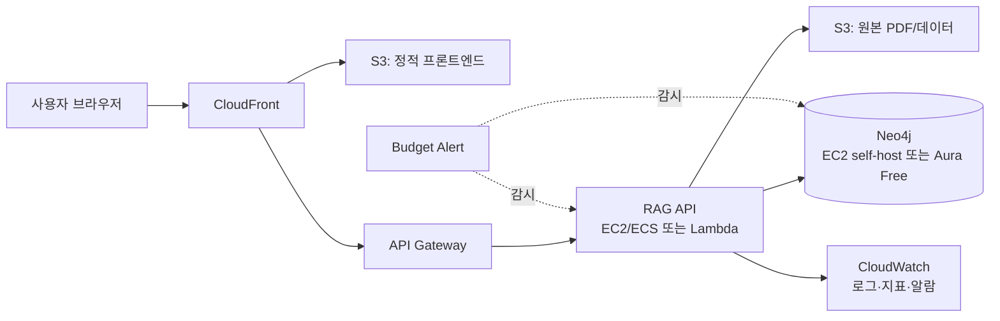

# 클라우드 학습 · 구축 · 운영 로드맵

> 목표: 퍼블릭 클라우드(AWS 중심)를 학기 프로젝트 기간(2~4개월, 소액 예산) 안에 스스로 공부하고, 본인 연구/프로젝트(예: PDF-Ontology-RAG, Qwen 평가, 주식 대시보드) 인프라를 실제로 올려서 운영까지 경험해본다.
>
> 이 문서는 살아있는 문서입니다. 진행하면서 계속 체크하고 내용을 고쳐나가세요. 주차별 진행 기록은 `docs/study-log.md`에 남기는 것을 추천합니다.

## 0. 시작하기 전에 정할 것

- **클라우드 사업자**: AWS를 1순위로 추천합니다. 프리티어가 가장 넓고, 자료/커뮤니티가 압도적으로 많고, 채용 시장에서도 표준처럼 쓰입니다. GCP는 대안으로 언급만 해두고, AWS로 개념을 익히면 이후 옮겨가는 데 큰 무리가 없습니다.
- **예산 원칙**: 학생 예산이므로 "프리티어 + 스팟 인스턴스 + 자동 종료"를 기본 습관으로 삼습니다. 매 실습 시작 전에 "이거 끄는 걸 잊으면 얼마 나오는지" 먼저 계산해보는 습관을 들이세요.
- **계정 안전장치**: AWS 가입 직후 반드시 (1) 루트 계정에 MFA 설정, (2) IAM 관리자 사용자 별도 생성 후 루트는 잠가두기, (3) Billing 콘솔에서 Budget Alert(예: $5, $10 단위)를 걸어두기. 이 세 가지는 로드맵의 다른 어떤 것보다 먼저 합니다.
- **"클라우드를 구축한다"는 것의 의미**: AWS 같은 사업자는 이미 전 세계 데이터센터에 하드웨어·네트워크를 깔아놓고 이를 EC2(가상서버), VPC(가상네트워크), S3(스토리지), RDS(DB) 같은 개별 서비스(레고 블록) 형태로 빌려줍니다. "구축"이라는 건 이 블록들을 조합·설정해서 "내 서비스가 돌아가는 나만의 가상 인프라"를 설계·배치하는 행위를 뜻하고, 이걸 사람이 콘솔에서 손으로 하는 대신 Terraform 같은 코드로 정의해두는 것이 "코드로 구축(IaC)"입니다. 즉 지금 로드맵에서 말하는 구축은 전부 AWS의 기능(서비스)을 조합하는 것이며, 하드웨어·데이터센터 자체를 짓는 것이 아닙니다 — 그건 Phase 0에서 대안으로 잠깐 언급했던 온프레미스/프라이빗 클라우드(OpenStack, Proxmox 등) 경로에 해당합니다.

## 1. 공부해야 할 것 — 단계별 커리큘럼

### Phase 0 (1~2주): 기초 다지기
- 리눅스 기본: 파일 시스템 구조, 프로세스/권한(chmod, sudo), systemd로 서비스 관리, SSH 키 기반 접속
- 네트워킹 기초: IP/서브넷/CIDR, DNS 동작 원리, TCP vs UDP, HTTP/HTTPS와 TLS 인증서 개념, 방화벽 개념
- Git/GitHub 협업 워크플로: 브랜치 전략, PR, `.gitignore`, 커밋 단위 — 이후 인프라 코드(IaC)를 이 저장소로 버전관리할 것이므로 처음부터 습관화
- 클라우드 핵심 개념: On-prem vs IaaS/PaaS/SaaS, 리전(Region)과 가용영역(AZ), 공동 책임 모델(Shared Responsibility Model), 탄력성(Elasticity)과 확장성(Scalability)의 차이

### Phase 1 (2~3주): AWS 코어 서비스
- **IAM**: 사용자/그룹/역할(Role)/정책(Policy), 최소 권한 원칙(least privilege)
- **VPC**: 서브넷(퍼블릭/프라이빗), 라우팅 테이블, 인터넷 게이트웨이(IGW)/NAT 게이트웨이, 보안그룹(Security Group) vs 네트워크 ACL 차이
- **EC2**: 인스턴스 타입 고르는 법, AMI, 키페어, EBS 볼륨, 스냅샷
- **S3**: 버킷 정책, 퍼블릭 접근 차단, 버저닝, 수명주기(Lifecycle) 규칙으로 비용 절감
- **RDS** (또는 필요 시 자체 호스팅 DB와 비교): 백업/스냅샷, 프리티어 범위
- **ELB + Auto Scaling**: 로드밸런서 개념, 오토스케일링 그룹 (개인 프로젝트에서는 초반엔 생략 가능, 개념만 익혀두기)
- **Route 53 / CloudFront**: 도메인 연결, CDN을 통한 정적 콘텐츠 배포
- **Billing / Cost Explorer / Budgets**: 프리티어 사용량 확인 습관, 예산 알람

### Phase 2 (2~3주): 컨테이너 & 배포
- Docker 심화 (Neo4j를 Docker로 다뤄본 경험이 있으니 그 위에 확장): 멀티스테이지 빌드, 볼륨, 네트워크
- ECR: 컨테이너 이미지 레지스트리
- 배포 방식 선택: 예산을 고려하면 **EC2 한 대 + Docker Compose**로 시작하고, 감이 잡히면 **ECS Fargate**로 옮겨보는 순서를 추천 (Fargate/EKS는 프리티어가 좁고 개인 프로젝트 규모에서 비용 대비 학습 효율이 낮음)
- Nginx 리버스 프록시 구성, HTTPS 적용 (ACM 또는 Let's Encrypt/Certbot)
- 컨테이너 로그를 CloudWatch Logs로 보내는 법

### Phase 3 (2주): IaC(코드형 인프라) & CI/CD
- **Terraform** 기초: provider, resource, state 파일 개념, module로 재사용
  - 왜 중요한가: 지금 이 폴더가 GitHub에 연결되어 있으므로, 인프라를 콘솔 클릭이 아니라 Terraform 코드로 정의해두면 "무엇을 만들었는지"가 git 히스토리에 그대로 남고 재현 가능해집니다.
- **GitHub Actions**로 CI/CD 파이프라인: lint → build → (테스트) → deploy 자동화
- 환경 분리: 개인 프로젝트 규모에서는 dev/prod 정도로 단순화

### Phase 4 (2~3주): 연구/ML 인프라 특화 (본인 프로젝트와 직결)
- **GPU 인스턴스**: g4dn/g5 계열 스팟 인스턴스로 비용 절감, 사용 후 자동 종료 스크립트/Lambda 스케줄러 필수
- **모델 서빙**: SageMaker(관리형, 비용 높음) vs EC2에 직접 FastAPI + vLLM/HF Transformers로 서빙(자유도 높고 저렴) — 학습 목적과 예산을 고려하면 후자를 추천
- **그래프/벡터 DB 운영**: 예전에 진행한 Neo4j Docker→클라우드 마이그레이션 분석을 실제로 실행해보는 단계. Neo4j Aura Free(관리형, 용량 제한) vs EC2 self-host(자유도 높음, 직접 백업/패치 필요) 비교 후 결정
- **경량 API**: Lambda + API Gateway로 RAG 질의응답 같은 이벤트성 엔드포인트 구성 (상시 EC2보다 저렴할 수 있음)
- **데이터 파이프라인**: S3(원본 PDF/데이터셋) → 처리(EC2/Lambda) → 결과 저장(S3 또는 DB)

### Phase 5 (지속적으로): 운영(Operations) 지식
구축은 한 번이지만 운영은 계속됩니다. 아래 항목들은 서비스를 띄운 이후 꾸준히 챙겨야 하는 지식입니다.

- **모니터링**: CloudWatch 지표/알람(CPU, 디스크, 네트워크), 필요 시 Grafana+Prometheus 조합
- **로깅**: 중앙 로그 수집과 보존 정책 (언제 지울지도 비용 문제)
- **비용 관리**: Budget Alert, 안 쓰는 리소스 자동 종료(Lambda 스케줄러 또는 Instance Scheduler), Cost Anomaly Detection
- **보안 운영**: 정기적인 IAM 권한 점검, 보안그룹 최소 개방, 자격증명은 반드시 Secrets Manager/Parameter Store로 관리하고 **절대 git에 커밋하지 않기** (`.gitignore`로 원천 차단)
- **백업/복구(DR)**: EBS 스냅샷 주기, S3 버저닝, RDS 자동 백업, "서버가 죽으면 어떻게 복구할지" 미리 문서화(runbook)
- **배포 전략**: 개인 프로젝트 규모에서는 롤링 배포만으로 충분, 블루/그린은 개념만 이해해두기
- **문서화 습관**: 아키텍처 다이어그램, 변경 이력 기록 — 이것도 이 git 저장소의 `docs/`에 계속 쌓아가기

## 2. 단계별 추천 학습 자료

같은 Phase 번호끼리 대응됩니다. 전부 무료거나(공식 문서/트레이닝) 가격 대비 만족도가 검증된 것들만 골랐습니다.

### 공통 (전 구간에서 계속 참고)
- **AWS 공식 문서** (docs.aws.amazon.com): 용어를 한 번 익힌 뒤에는 결국 여기가 제일 정확합니다.
- **AWS Skill Builder** (skillbuilder.aws): AWS 공식 무료 학습 플랫폼. 서비스별 짧은 강의와 실습이 잘 정리되어 있음.
- **AWS Workshop Studio** (workshops.aws): 공식 핸즈온 실습 모음 — VPC, ECS, Terraform 등 이번 로드맵과 거의 그대로 겹치는 워크숍이 많음.
- **AWS Well-Architected Framework** (공식 백서, 무료 PDF): 보안·비용·안정성·운영 우수성을 관통하는 표준 체크리스트. Phase 5 운영 지식을 한 번 정리할 때 특히 유용.

### Phase 0 — 기초
- 리눅스: Linux Journey(linuxjourney.com, 무료·인터랙티브)
- 네트워킹: 「그림으로 배우는 네트워크 원리」(Miya Miyauchi, 한빛미디어) — 국내에서 가장 쉬운 입문서로 꼽힘
- 클라우드 개념 전체: **AWS Skill Builder의 "AWS Cloud Practitioner Essentials"** (무료, 약 6시간) — Phase 0~1 개념을 한 번에 훑어줌. 이걸 먼저 듣고 Phase 1로 들어가는 걸 추천

### Phase 1 — AWS 코어 서비스
- 책: 「AWS를 다루는 기술」(이재홍 저, 위키북스) — VPC/EC2/S3/RDS를 실습 위주로 다루는 국내 표준 입문서. 지금 로드맵의 Phase 1과 구성이 거의 일치함
- 영상: freeCodeCamp의 "AWS Certified Cloud Practitioner" 무료 강의(YouTube, 영어)
- 실습: AWS Workshop Studio의 VPC/EC2 관련 워크숍

### Phase 2 — 컨테이너 & 배포
- 책: 「가장 쉬운 도커 & 쿠버네티스 실전 입문」(용찬호 저) — Docker 파트만 먼저 봐도 충분
- ECS/Fargate: AWS Workshop Studio의 "ECS Workshop"
- HTTPS: Certbot 공식 가이드(certbot.eff.org)

### Phase 3 — IaC & CI/CD
- **HashiCorp 공식 Terraform 튜토리얼**(developer.hashicorp.com/terraform/tutorials) — AWS 트랙이 따로 있고 전부 무료
- 책(선택, 더 깊게 갈 때): 「Terraform: Up & Running」— 업계 표준 교재
- GitHub Actions: GitHub 공식 문서의 "Quickstart" + "Deploying to Amazon EC2" 가이드

### Phase 4 — 연구/ML 인프라
- AWS 공식 블로그의 "Machine Learning" 카테고리, SageMaker/EC2 GPU 관련 포스트
- vLLM 공식 문서(직접 서빙 시)
- EC2 Spot: AWS 공식 "Spot 인스턴스 모범 사례" 문서
- Neo4j Aura 공식 마이그레이션 가이드 (기존에 진행했던 Neo4j Docker→클라우드 분석과 바로 이어붙이기 좋음)

### Phase 5 — 운영
- AWS Well-Architected Framework (위 공통 항목)
- AWS 공식 "Budgets & Cost Management" 가이드

## 3. 바로 따라 할 수 있는 튜토리얼 문서

"자료를 보는 것"과 "손 따라 실습하는 것"은 다르므로, 직접 클릭/타이핑하며 따라갈 수 있는 공식 튜토리얼만 모았습니다. Phase 순서대로 진행하세요.

1. **[AWS Cloud Practitioner Essentials](https://skillbuilder.aws/learn/94T2BEN85A/aws-cloud-practitioner-essentials/8D79F3AVR7)** (Skill Builder, 무료, 영상형) — Phase 0의 클라우드 개념을 처음부터 끝까지 강의로 훑어줌. 가장 먼저 볼 것.
2. **[AWS 공식 Hands-On 튜토리얼 허브](https://aws.amazon.com/getting-started/hands-on/)** — 서비스 하나씩 "10~30분 안에 따라하기" 형식의 짧은 공식 튜토리얼 모음. 그중 Phase 1과 바로 연결되는 것:
   - [Launch a Virtual Machine](https://aws.amazon.com/getting-started/hands-on/launch-a-virtual-machine/) — EC2(또는 Lightsail)로 첫 가상서버 띄우기
   - 같은 허브 안에서 "Host a Static Website", "Build a Web App" 항목도 Phase 1~2 실습과 바로 이어짐
3. **[W3Schools AWS Tutorial](https://www.w3schools.com/aws/)** — 글로 읽는 스텝바이스텝 튜토리얼. 영상보다 텍스트로 빠르게 훑고 싶을 때, 또는 나중에 특정 서비스만 다시 찾아볼 때 유용.
4. **[Terraform: AWS Get Started](https://developer.hashicorp.com/terraform/tutorials/aws-get-started)** (HashiCorp 공식) — Phase 3용. `install-cli` → `aws-create`(첫 리소스 생성) → `aws-manage`(변경/삭제) 순서로 진행하면 됨.
5. **[Introduction to Terraform on AWS](https://catalog.workshops.aws/terraform101)** (AWS Workshop Studio) — 위 4번을 마친 뒤, AWS 계정에서 실제로 더 큰 시나리오로 연습해보는 심화 워크숍.

이 문서에 링크만 있고 아직 진행 기록은 없으니, 하나 끝낼 때마다 `docs/study-log.md`에 체크해나가면 좋습니다.

## 4. 구축(Build) — 실습 프로젝트 제안 (난이도 순)

실습은 "아무거나 다 해보고 싶다"는 방향에 맞춰, 작은 성공부터 본인 연구 인프라까지 단계적으로 확장하는 순서를 추천합니다.

1. **입문**: 정적 사이트 하나를 S3 + CloudFront로 배포 (도메인 연결까지). 클라우드 전체 흐름(콘솔→리소스 생성→접속 확인→비용 확인)을 가장 빠르게 체감할 수 있는 실습
2. **중급**: 이미 만들어둔 주식 대시보드(Flask + Plotly)를 EC2 + Nginx로 배포. 기존 프로젝트라 바로 실습 가능하고, 프로세스 상시 구동/재시작(systemd), 도메인/HTTPS 적용까지 한 번에 연습
3. **심화**: PDF-Ontology-RAG를 클라우드 아키텍처로 재구성
   - Neo4j: EC2 self-host 또는 Aura Free
   - RAG API: EC2/ECS 컨테이너 또는 Lambda
   - PDF 원본: S3
   - 프론트: S3 + CloudFront
   - 전체를 Terraform으로 코드화해서 `infra/` 폴더에 커밋
4. **도전 (선택)**: Qwen2.5-3B 평가/파인튜닝 파이프라인을 GPU 스팟 인스턴스 위에서 돌리고, 체크포인트는 S3에 저장, 작업 종료 시 자동 종료되도록 스크립트화 — 비용 통제와 ML 인프라 운영을 동시에 연습

### 참고 아키텍처 (3번 심화 실습 기준)



## 5. 이 저장소(Git) 정리 원칙

폴더가 GitHub에 연결되어 있으므로, 앞으로 자료가 늘어나도 아래 구조를 기본으로 유지하는 것을 추천합니다.

```
Cloud_Study/
  README.md              # 프로젝트 개요, 이 로드맵으로 링크
  docs/
    roadmap.md            # 이 문서
    study-log.md          # 주차별 진행 기록
    architecture/          # 아키텍처 다이어그램 (필요 시 파일 분리)
  infra/
    terraform/             # 인프라 코드 (환경별 폴더/모듈)
  apps/
    stock-dashboard/        # 실습 2번 앱 코드
    pdf-rag-api/             # 실습 3번 앱 코드
  scripts/
    cost-guard/              # 자동 종료·비용 감시 스크립트
  .gitignore
```

**커밋 규칙**
- Terraform state 파일(`*.tfstate*`), `.tfvars`에 담긴 민감정보, `.env` 파일, 자격증명(pem, json key)은 절대 커밋하지 않습니다. 이미 만들어둔 `.gitignore`가 기본적으로 막아줍니다.
- 콘솔에서 리소스를 수동으로 만들었더라도, 익숙해지면 최대한 빨리 Terraform 코드로 옮겨서 커밋하는 습관을 들이세요. "클릭으로 만든 것은 git에 안 남는다"고 생각하면 됩니다.
- 매 실습 단계가 끝나면 `docs/study-log.md`에 날짜/한 일/막힌 점/비용을 짧게 기록하고 커밋하세요.
